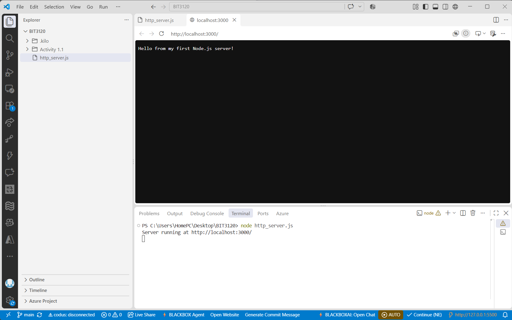

# Learning-Serverside-JS

## Introduction
A collection of notes and exercises from my journey learning backend development, with a focus on Node.js and Express.

## What's Inside
- `http_server.js`: a basic HTTP server built with Node's core `http` module

## Prerequisites
- [Node.js](https://nodejs.org) (v18 or higher)
- npm

Check your versions:

```bash
node -v
npm -v
```

## Installation & Usage

1. Clone the repository:
```bash
   git clone https://github.com/Greenbird122/Learning-Serverside-JS
   cd Learning-Serverside-JS
```

2. Run the server:
```bash
   node http_server.js
```

3. You should see something like this:

   

## Contact
Questions or issues? Open an [issue](https://github.com/Greenbird122/Learning-Serverside-JS/issues) or reach out via my GitHub profile.

*This is just the beginning of something greater. Welcome to my journey!*